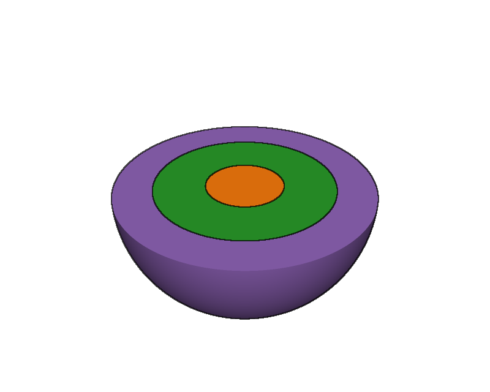
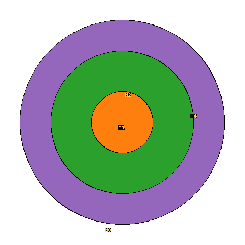

<!--
SPDX-FileCopyrightText: 2026 Giovanni MARIANO

SPDX-License-Identifier: MPL-2.0
-->

# libalea.c

A C library for building, debugging, and analyzing Constructive Solid Geometry (CSG) models used in neutron and gamma transport simulations.

**The library is under active development. The API may change.**

**[Read the documentation](https://giovanni-mariano.github.io/libalea.c/)**

| 3D cutaway | Central slice (z = 0) |
| :---: | :---: |
|  |  |

An illustrative source region (orange, radius 3 cm) inside two shielding layers
(green to 7 cm, purple to 10 cm). Images generated by libalea; colors identify
material regions, not simulation results.

## Hello World

```c
#include <alea.h>
#include <alea_mcnp.h>
#include <stdio.h>

int main(void) {
    mcnp_model_t* model = mcnp_load("geometry.inp");
    if (!model) {
        fprintf(stderr, "load failed: %s\n", alea_error());
        return 1;
    }

    alea_system_t* sys = model->sys;
    alea_build_universe_index(sys);

    int cell = 0;
    int mat = 0;
    if (alea_find_cell_at(sys, 100.0, 0.0, 0.0, &cell, &mat) == 0)
        printf("Cell %d, material %d\n", cell, mat);

    mcnp_model_destroy(model);
    return 0;
}
```

```bash
gcc -o hello hello.c -Iinclude bin/libalea_mcnp.a bin/libalea.a -lm
```

## What It Does

- **Load** MCNP, OpenMC, and native ALEA XML models
- **Query** which cell and material exists at any point
- **Detect** overlapping cells and undefined regions with sampled diagnostics
  or bounded, verified slice scans
- **Trace** rays through the model and report every cell crossing
- **Visualize** 2D cross-sections with exact analytical surface boundaries
- **Render** 3D images with Phong shading, cutaway views, and shadow rays
- **Sample and export** CSG onto structured rectilinear grids in Gmsh (.msh) and VTK (.vtk) formats (exp.)
- **Generate** void regions to fill gaps in the geometry
- **Convert** between MCNP, OpenMC, native ALEA XML, and Serpent formats
- **Build** geometry programmatically with boolean operations
- **Materials** definition with nuclide/element composition and mixture support
- **Nuclear data** read ACE-format cross sections (neutron, photon), sample free paths, target nuclides, reaction MTs, and multigroup scattering, Doppler broaden, and collapse to multigroup constants

Native `.alea.xml` files preserve geometry together with cell density, names,
comments, importances, typed cell parameters, and per-nuclide library extensions.
See the [ALEA XML format guide](docs/ALEA_XML_FORMAT.md).

## Installation

### Pre-built Binaries

Download pre-built binaries from [GitHub Releases](https://github.com/giovanni-mariano/libalea.c/releases):

| Platform | Archive |
|----------|---------|
| Linux x64 | `alea-linux-x64.tar.gz` |
| Linux ARM64 | `alea-linux-arm64.tar.gz` |
| macOS Intel | `alea-macos-x64.tar.gz` |
| macOS Apple Silicon | `alea-macos-arm64.tar.gz` |
| Windows x64 (MinGW/UCRT) | `alea-windows-x64.zip` |
| Windows x64 (MSVC) | `alea-windows-msvc-x64.zip` |

The Linux, macOS, and MinGW/UCRT Windows archives package the `alea` CLI,
`mc_convert`, `mc_plotter`, `render3d`, `nuc_plot`, `nuc_inventory`, `large_model_probe`, static libraries,
and headers. The MSVC archives package the `.lib` static libraries and headers.
All builds use the vendored TinyPar backend by default and have no OpenMP
runtime dependency.

An experimental optional [GPU module](docs/GPU_COMPUTE.md) provides Metal FP32
rendering and CPU/Metal point classification for nested transformed fills.
Point classification currently rejects lattices. Build the
interactive viewer with `make tools USE_METAL=1 USE_SDL=1` and select
`render3d --backend metal --interactive` for automatic coarse previews and
cancellable tile refinement with automatic bounds. Metal supports transformed universes,
rectangular lattices, quadrics, cones and tori. CUDA and HIP backends are planned as separate native implementations, without
a GPU portability framework. See the [native GPU roadmap](docs/NATIVE_GPU_GEOMETRY.md).

The native CLI archives include `examples/lua` and `examples/python`.
Python binding archives include the Python scripts under `examples/`.

Release pages also contain the native Python bindings as `pyalea` archives for
CPython 3.12–3.14 on Linux x86_64/aarch64, macOS x86_64/arm64, and Windows
x86_64. Each archive is specific to its Python ABI and platform and includes a
matching `.sha256` file. Applications can bundle the contained `pyalea/`
directory and use `import pyalea`; see
[`bindings/python/README.md`](bindings/python/README.md) for the artifact layout
and local build commands.

### Building from Source

Use a C11 compiler and GNU Make on Linux, macOS, or MinGW:

```bash
git clone --recursive https://github.com/giovanni-mariano/libalea.c.git
cd libalea.c
make full cli tools
make test-unit test-integration test-lua
```

Add `RELEASE=1 PORTABLE=1` for an optimized, portable build. Native threading
uses TinyPar; set `ALEA_NUM_THREADS` to limit the worker count.

For Windows MSVC, use `build-msvc.ps1 full` and `build-msvc.ps1 test`.
See the [installation guide](docs/INSTALLATION.md) for platform setup,
installation options, individual libraries, and optional MPI support.

## Python and Lua

Python release archives target **CPython 3.12–3.14 with NumPy 2.x**. Extract the
matching archive and add its top-level directory to `PYTHONPATH`, or bundle
its `pyalea/` directory with your application:

```python
import pyalea

system = pyalea.load_mcnp("geometry.inp")
system.build_universe_index()
print(system.find_cell(100.0, 0.0, 0.0))
```

The `alea` CLI runs Lua scripts or opens a REPL:

```bash
bin/alea
bin/alea examples/lua/02_build_geometry.lua
```

See the [Python guide](docs/PYTHON.md) and [Lua tutorial](docs/LUA_TUTORIAL.md)
for setup and API examples.

## Command-line Tools

| Tool | Purpose |
|------|---------|
| `mc_convert` | Convert MCNP, OpenMC, and ALEA XML models; export to Serpent |
| `mc_plotter` | Generate 2D cross-section images |
| `render3d` | Render shaded 3D images and cutaways |
| `nuc_plot` | Plot nuclear cross sections and distributions |
| `nuc_inventory` | Inspect nuclear-data capabilities |
| `large_model_probe` | Inspect and benchmark large geometry models |

```bash
bin/mc_convert model.inp model.alea.xml -of alea
bin/mc_plotter model.inp Z 0 -100 100 -100 100 800x800 output.png
```

## Examples and Documentation

Start with the [C examples](examples/c), [Lua scripts](examples/lua), or
[Python examples](examples/python). Geometry and visualization examples need
no nuclear data; transport examples require user-supplied ACE data.

| Guide | Contents |
|-------|----------|
| [Installation](docs/INSTALLATION.md) | Build, install, and link the libraries |
| [C tutorial](docs/TUTORIAL.md) | Load, inspect, and export a model |
| [Concepts](docs/CONCEPTS.md) | Surfaces, cells, universes, and lattices |
| [Geometry validation](docs/GEOMETRY_VALIDATION.md) | Gap and overlap diagnostics, verified slice queries |
| [Fixed-source transport](docs/FIXED_SOURCE_WORKFLOW.md) | Sources, nuclear data, and neutron/photon histories |
| [Nuclear-data capabilities](docs/NUCDATA_CAPABILITIES.md) | Supported data and transport physics |
| [API reference](docs/API.md) | Public C functions |
| [Architecture](docs/ARCHITECTURE.md) | Internal design for contributors |

## Disclaimer

This package was developed with support of AI tools.

## License

Mozilla Public License 2.0 (MPL-2.0). See [LICENSE](LICENSES/MPL-2.0.txt) for details.
